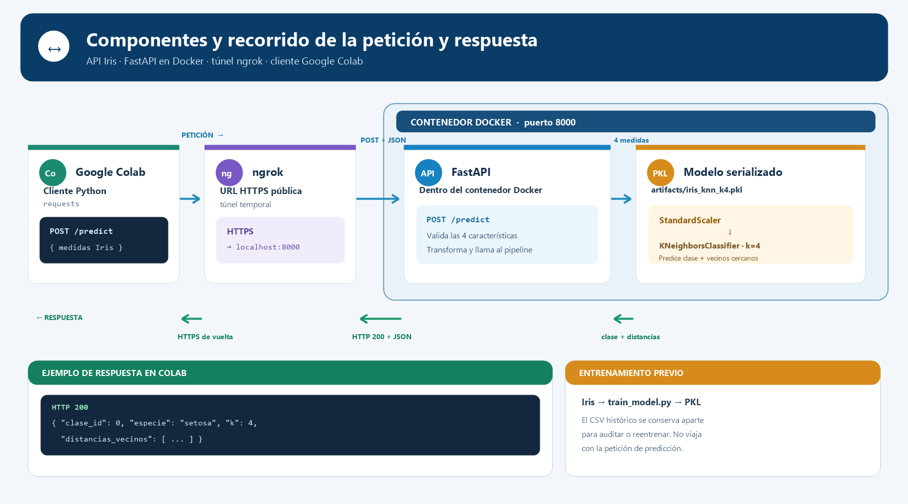
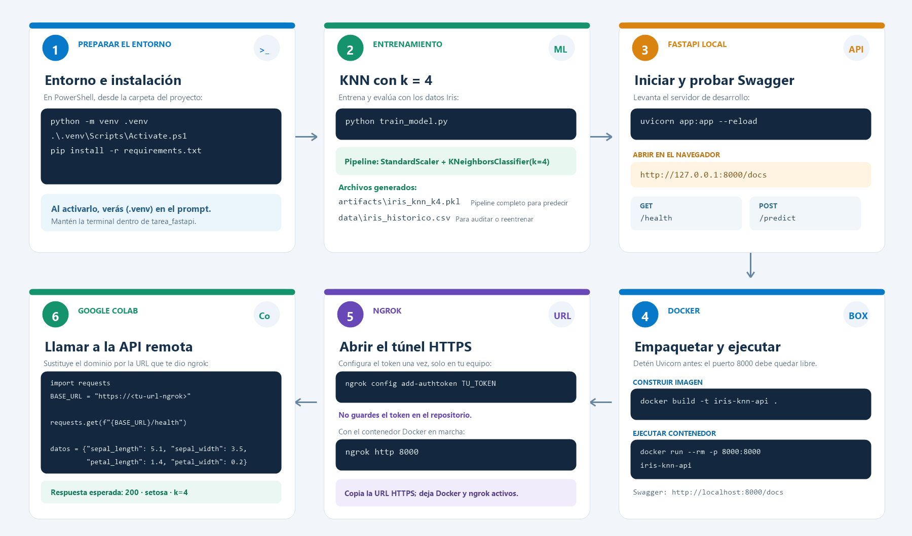

# API Iris con KNN

## Objetivo

Entrenar un clasificador KNN con el conjunto Iris y exponer predicciones mediante una API FastAPI. El modelo usa `StandardScaler` y `KNeighborsClassifier` con `k=4`.

## Componentes y archivos

- `train_model.py`: entrena y evalúa el modelo.
- `artifacts/iris_knn_k4.pkl`: pipeline ajustado y metadatos necesarios para predecir.
- `data/iris_historico.csv`: datos históricos guardados aparte para reproducibilidad o reentrenamiento; no se cargan en cada predicción.
- `app.py`: API FastAPI.
- `Pruebas_api.ipynb`: llamadas de prueba desde Google Colab con salidas guardadas.
- `diagrama_componentes_peticion_respuesta.png`: componentes y recorrido de la petición y la respuesta.

## Requisitos y entrenamiento

Requiere Python 3.11 recomendado. En PowerShell, desde esta carpeta:

```powershell
python -m venv .venv
.\.venv\Scripts\Activate.ps1
pip install -r requirements.txt
python train_model.py
```

El entrenamiento genera el PKL y el CSV histórico.

## Endpoints

| Método | Ruta | Función |
|---|---|---|
| GET | `/` | Mensaje de bienvenida y acceso a la documentación |
| GET | `/health` | Comprueba que la API y el modelo están disponibles |
| POST | `/predict` | Predice la especie a partir de cuatro medidas |

Ejemplo para `POST /predict`:

```json
{
  "sepal_length": 5.1,
  "sepal_width": 3.5,
  "petal_length": 1.4,
  "petal_width": 0.2
}
```

Respuesta de ejemplo: `200 OK`, especie `setosa`, `k=4` y las distancias a los cuatro vecinos más cercanos.

## Ejecutar con Docker y abrir Swagger

Con Docker Desktop iniciado y después de generar el PKL:

```powershell
docker build -t iris-knn-api .
docker run --rm -p 8000:8000 iris-knn-api
```

Abre <http://localhost:8000/docs> para probar `GET /health` y `POST /predict` desde Swagger. Mantén la terminal del contenedor abierta.

### Evidencia de Swagger

La prueba de salud devuelve HTTP 200 y confirma el clasificador con `k=4`:


La prueba de predicción devuelve HTTP 200 y clasifica las medidas de ejemplo como `setosa`:


## Exponer la API con ngrok

Con el contenedor Docker en ejecución, instala ngrok y configura el token de tu cuenta en tu equipo:

```powershell
ngrok config add-authtoken TU_TOKEN
ngrok http 8000
```

Copia la URL HTTPS que ngrok muestra y sustituye el dominio en el notebook. No guardes el token en el repositorio. La URL del túnel es temporal; Docker y ngrok deben seguir ejecutándose mientras haces las pruebas.

## Probar desde Google Colab

En `Pruebas_api.ipynb`, configura `BASE_URL` con la URL vigente de ngrok y ejecuta estas peticiones:

```python
import requests

BASE_URL = "https://<dominio-ngrok>"

requests.get(f"{BASE_URL}/health").json()
```

```python
datos = {
    "sepal_length": 5.1,
    "sepal_width": 3.5,
    "petal_length": 1.4,
    "petal_width": 0.2
}

requests.post(f"{BASE_URL}/predict", json=datos).json()
```

Salidas obtenidas en Colab:

```text
200
{'estado': 'ok', 'modelo': 'KNeighborsClassifier', 'k': 4}
```

```text
200
{'clase_id': 0, 'especie': 'setosa', 'distancias_vecinos': [3.3178273389207606, 3.5920967560334733, 4.4155514994342635, 4.737377248341377], 'k': 4}
```

El notebook conserva las celdas y sus salidas como evidencia de la prueba remota.

## Diagrama de componentes



## Flujo técnico por pasos


