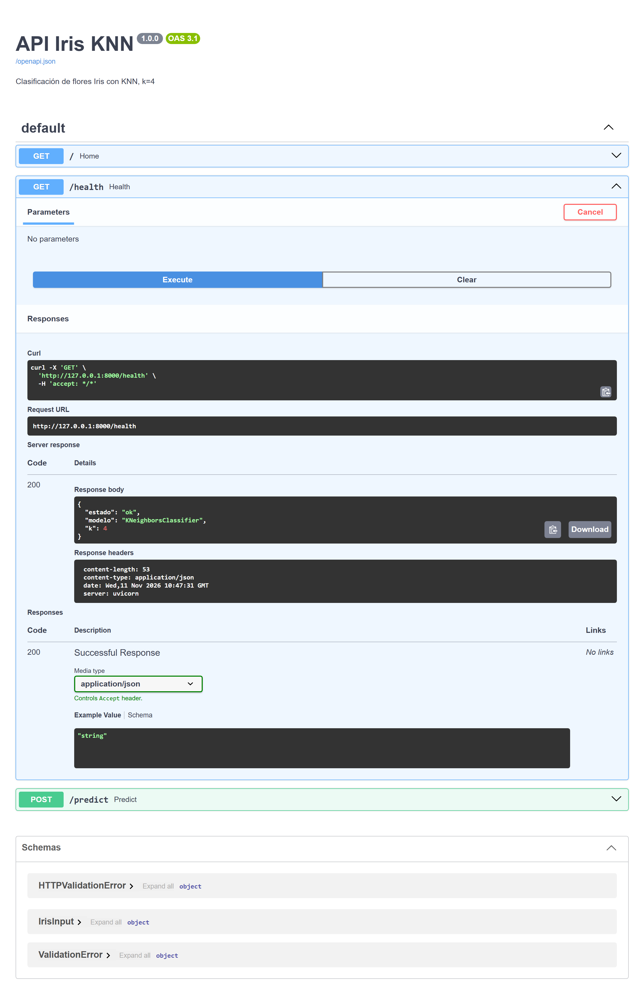
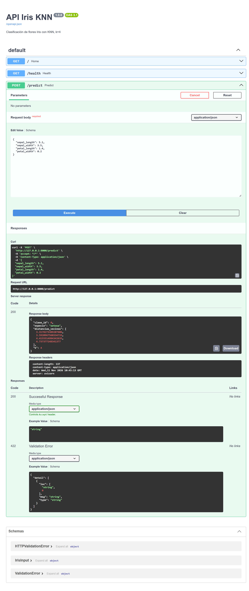

# Primera API

Este proyecto muestra el recorrido de una primera API: recibe las medidas de una flor, consulta el clasificador Iris y devuelve una respuesta JSON. La API se prueba en Swagger, se ejecuta dentro de Docker y se hace accesible desde Google Colab mediante un túnel HTTPS de ngrok.

## El recorrido de una petición

El cliente envía a `POST /predict` las cuatro medidas de una flor: largo y ancho del sépalo, y largo y ancho del pétalo. FastAPI valida los valores recibidos, los pasa al clasificador disponible en la aplicación y devuelve la especie estimada, su identificador y las distancias a los cuatro vecinos más cercanos.

`GET /health` permite comprobar que la API está activa y que el clasificador está disponible. La ruta `/` presenta un mensaje de bienvenida y señala la documentación interactiva.

| Método | Endpoint | Respuesta |
|---|---|---|
| GET | `/` | Mensaje de bienvenida y acceso a `/docs` |
| GET | `/health` | Estado de la API y nombre del clasificador |
| POST | `/predict` | Especie estimada, identificador, distancias y valor de `k` |

Ejemplo de cuerpo para `POST /predict`:

```json
{
  "sepal_length": 5.1,
  "sepal_width": 3.5,
  "petal_length": 1.4,
  "petal_width": 0.2
}
```

Con esas medidas, la respuesta observada fue `200 OK` y la especie estimada fue `setosa`.

## La API en local y Swagger

Durante la prueba local, Uvicorn sirve la aplicación en el puerto 8000:

```powershell
uvicorn app:app --reload
```

Swagger presenta automáticamente los endpoints en <http://127.0.0.1:8000/docs>. Desde esa página se ejecutaron `GET /health` y `POST /predict` y se comprobaron sus respuestas.

### Evidencia de Swagger

`GET /health` respondió con estado `ok` y `k=4`:



`POST /predict` respondió con la clase `setosa`:



## La misma API dentro de Docker

Docker empaqueta la aplicación y sus dependencias en una imagen. El contenedor publica el puerto 8000 del servicio en el puerto 8000 del equipo:

```powershell
docker build -t iris-knn-api .
docker run --rm -p 8000:8000 iris-knn-api
```

Con el contenedor activo, la documentación de Swagger queda disponible en <http://localhost:8000/docs>. Para iniciar Docker después de una ejecución local de Uvicorn, el puerto 8000 debe estar libre.

El entorno empleado incluye Python 3.11, los paquetes indicados en `requirements.txt` y Docker Desktop. La carpeta `artifacts` debe contener `iris_knn_k4.pkl`, que la API carga al arrancar.

## Acceso desde Google Colab a través de ngrok

ngrok crea una dirección HTTPS temporal que reenvía las peticiones al puerto 8000 local. Con una cuenta de ngrok, el agente se configura una vez en el equipo y el túnel se inicia mientras el contenedor está activo:

```powershell
ngrok config add-authtoken TU_TOKEN
ngrok http 8000
```

El token permanece en la configuración local de ngrok y no se incluye en el repositorio. La URL HTTPS que aparece en la terminal se usa como `BASE_URL` en Colab; cambia al iniciar otro túnel. Docker y ngrok permanecen activos mientras se ejecuta el notebook.

En `Pruebas_api.ipynb`, `requests` realiza una comprobación de salud y una predicción usando esa URL:

```python
import requests

BASE_URL = "https://<dominio-ngrok>"

requests.get(f"{BASE_URL}/health").json()
```

```python
datos = {
    "sepal_length": 5.1,
    "sepal_width": 3.5,
    "petal_length": 1.4,
    "petal_width": 0.2
}

requests.post(f"{BASE_URL}/predict", json=datos).json()
```

### Salidas registradas en Colab

La comprobación de salud devolvió:

```text
200
{'estado': 'ok', 'modelo': 'KNeighborsClassifier', 'k': 4}
```

La predicción devolvió:

```text
200
{'clase_id': 0, 'especie': 'setosa', 'distancias_vecinos': [3.3178273389207606, 3.5920967560334733, 4.4155514994342635, 4.737377248341377], 'k': 4}
```

El notebook conserva las celdas y sus salidas, de modo que permite seguir la petición completa desde Colab hasta la respuesta de la API.
